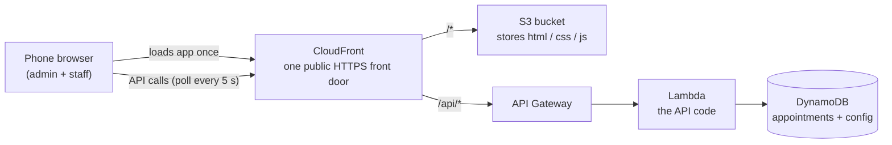
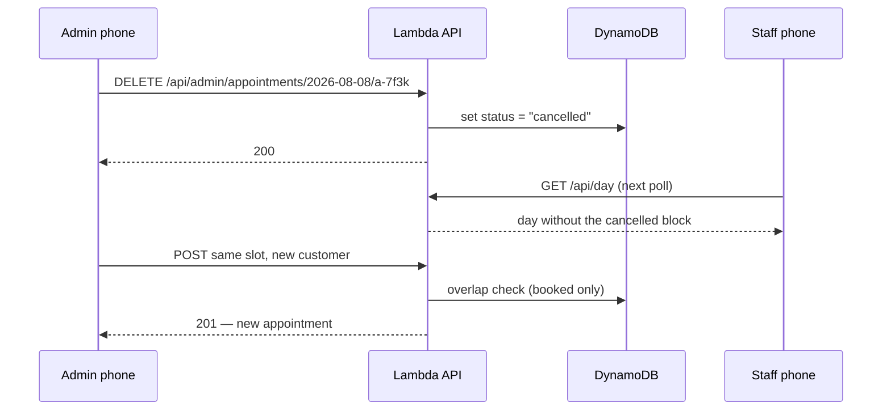

# Scheduling system — design

A small web app for a family massage parlor. The admin (owner) adds and cancels
appointments while on the phone with customers; staff open a URL on their own
phones and see the day's schedule update live. No app installs, no logins for v1.

## Requirements

| # | Requirement |
|---|---|
| FR-1 | Day timetable: therapist names across the top, times down the side, appointments as colored blocks |
| FR-2 | Each block shows service name, length, and customer name |
| FR-3 | Only admin can add/edit; staff view is read-only |
| FR-4 | Staff see only the last 4 digits of customer phone numbers |
| FR-5 | Add and delete (cancel) appointments |

## Architecture at a glance

Serverless on AWS, deployed with Pulumi (infrastructure as code, TypeScript).
Nothing runs when the store is closed; expected cost ≈ $0/month at this scale.



How it works in one sentence: the phone downloads the app once from S3 via
CloudFront, the app runs entirely in the browser, and it re-asks the Lambda API
for the current day every few seconds — that polling *is* the live update.

## The screen

One day at a time. Columns = therapists, rows = time. Block color = service
type. On phones the time column stays pinned and therapist columns scroll
sideways.

|       | Anna | Mei | Ken |
|-------|------|-----|-----|
| 10:00 | Deep tissue · 60 · Sarah (•••-4821) | | |
| 10:30 | ↑ | Swedish · 90 · Linda (•••-0977) | |
| 11:00 | | ↑ | Combo · 60 · Grace (•••-8264) |

- **Admin view** (`/admin`): full phone numbers, tap empty slot → add form, tap block → cancel.
- **Staff view** (`/`): same grid, read-only, phones masked.

## Roles without logins

There is no authentication in v1 — but the boundary is still enforced
**server-side**, not hidden in the UI:

- The staff endpoint never sends full phone numbers (it sends `phoneLast4` only)
  and accepts no writes. What never reaches the phone can't be revealed.
- All writes and full data live under `/api/admin/...`.
- Later, a PIN check on the admin routes adds real protection with zero redesign.

## API — four endpoints

| Method + path | Who | Purpose |
|---|---|---|
| `GET /api/day?date=YYYY-MM-DD` | staff | Day schedule, phones masked |
| `GET /api/admin/day?date=YYYY-MM-DD` | admin | Same, full phone numbers |
| `POST /api/admin/appointments` | admin | Add an appointment |
| `PUT /api/admin/appointments/{date}/{id}` | admin | Edit an appointment (same-day fields) |
| `DELETE /api/admin/appointments/{date}/{id}` | admin | Cancel (soft delete) |
| `PUT /api/admin/roster/{date}` | admin | Set that day's therapist columns (ordered) |

The day response contains **everything needed to draw the screen** in one call:

```json
{
  "date": "2026-08-08",
  "therapists": [ { "id": "t-anna", "name": "Anna" } ],
  "services":   [ { "id": "s-deep", "name": "Deep tissue", "durationMin": 60, "color": "teal" } ],
  "appointments": [
    {
      "id": "a-7f3k",
      "therapistId": "t-anna",
      "serviceId": "s-deep",
      "customerName": "Sarah M",
      "phoneLast4": "4821",
      "start": "10:00",
      "durationMin": 60,
      "status": "booked"
    }
  ]
}
```

Admin day responses are identical except `phone` (full) replaces `phoneLast4`.
Notes are visible to both views; only the phone number is masked for staff.

Rules on `POST`:
- `durationMin` optional — defaults from the service.
- `phone` / `notes` optional (walk-ins).
- Overlap with an existing **booked** appointment for that therapist → `409`
  with a human-readable message. Bad input → `400`.

## Cancel and rebook

Cancelling sets `status: "cancelled"` instead of erasing the record (keeps a
no-show history for free). Two rules make this safe:

1. Day responses **skip** cancelled appointments — they vanish from every grid.
2. The overlap check considers **booked records only** — a cancelled record
   never blocks the slot again, so the slot is immediately rebookable
   (including partial overlaps, e.g. rebooking at 10:30 over a cancelled 10:00–11:00).



## Data model (DynamoDB)

One table. Appointments are filed under their date so drawing a day is a
single query.

| Item | PK | SK | Attributes |
|---|---|---|---|
| Appointment | `2026-08-08` | `a-7f3k` | therapistId, serviceId, customerName, phone, start, durationMin, notes, status, createdAt |
| Roster | `2026-08-08` | `ROSTER` | therapistIds[] (ordered = column order), updatedAt |
| Config | `CONFIG` | `current` | therapists[], services[] |

Day responses resolve columns from the roster item (it rides along in the same
partition query). No roster saved → the first four therapists in the config
show as the default. A therapist with a booking that day always gets a column,
even if left off the roster.

Therapists and services are seed data loaded at deploy; no editing UI until the
menu actually changes.

## Conventions

- Dates `YYYY-MM-DD`, times `"HH:MM"` 24-hour, all in **store local time**
  (one store → no timezone conversion, ever).
- IDs generated server-side.
- Polling interval 5 s; can be upgraded to push (SSE) later if ever needed.

## Deliberately not in v1

- Moving an appointment to a different date (edit covers same-day changes;
  cross-day = cancel + re-add, since the date is the partition key)
- Authentication (add a PIN on `/api/admin/*` when wanted)
- Week view, therapist working hours, menu editing, customer history views

## Open items

- ~~Real therapist names~~ — Summer, Cindy, Mona, Helen, Sub 1, Sub 2
- ~~Service menu~~ — Lomi Lomi, Deep Tissue, Swedish, Combo, Foot Massage
  (durations set manually per booking; add-ons like hot stone go in notes)
- Store hours: grid currently shows 10:00–20:00 (`OPEN_MIN`/`CLOSE_MIN` in
  web/app.js) — confirm against the real store schedule

## Deployed (2026-08-10)

- Staff: https://private-url-removed.example
- Admin: https://private-url-removed.example/admin.html
- Static files are served uncached (instant deploys); only `/api/*` was ever
  dynamic. Local frontend dev: `node dev-server.mjs` → localhost:4173.
