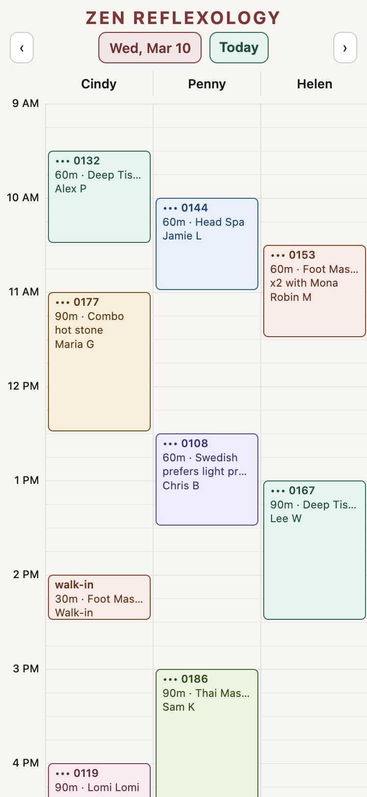
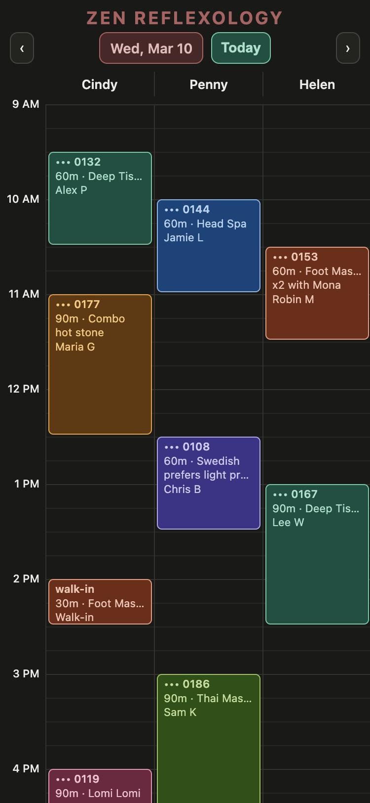
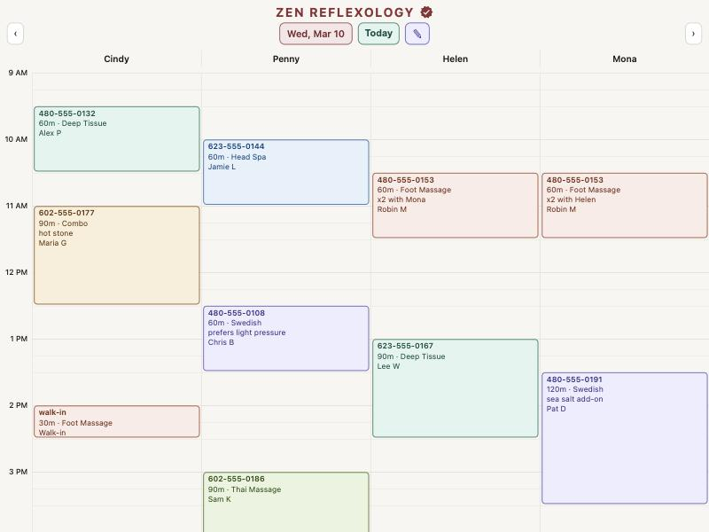
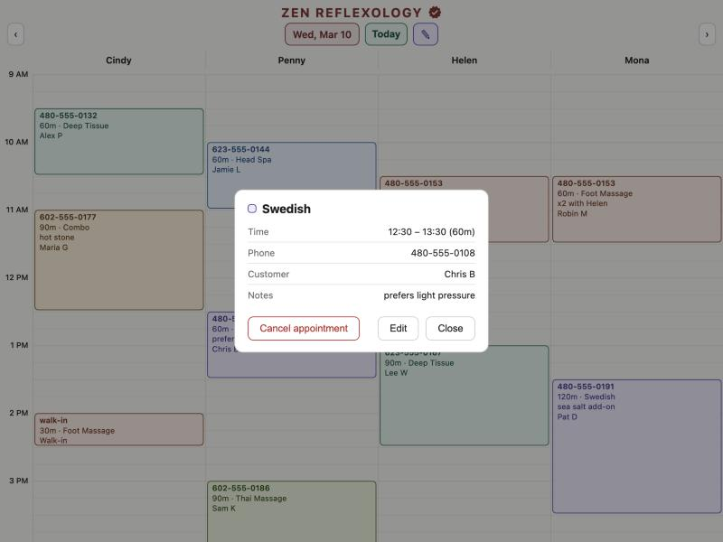
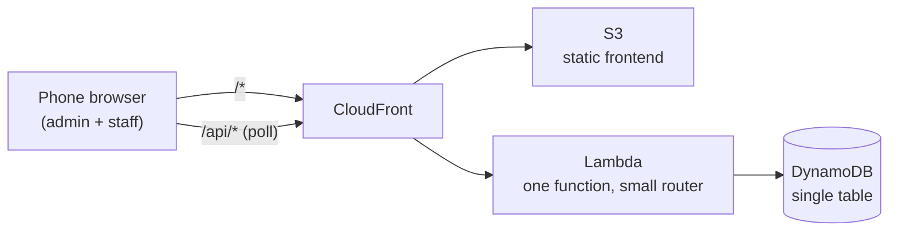

# Zen Reflexology — Scheduling System

A phone-first appointment scheduler built for my family's massage studio —
**in daily production use at the store since August 2026**. The owner books
appointments while on the phone with customers; therapists check their day
from their own phones and see new bookings appear within seconds.

Runs serverless on AWS for roughly **$0/month**.

  
  

  

  

*All customer data shown is fictional.*

## Features

- **Live day grid** — therapists as columns, time down the side, bookings as
  color-coded blocks (one color per service). Every phone polls the API and
  reflects changes within ~5 seconds.
- **Two roles, no logins** — the admin page can book, edit, and cancel; the
  staff page is read-only. The split is enforced server-side: the staff
  endpoint accepts no writes and **never sends full phone numbers** (staff
  see `••• 1234`), so privacy doesn't depend on the browser.
- **Daily staff roster** — the admin picks who's working each day and in
  which column order; unset days fall back to a sensible default. Anyone
  with a booking always gets a column, so appointments can never be hidden.
- **Conflict-checked booking** — overlapping appointments are rejected with
  a readable message. Cancellations are soft deletes, so a freed slot is
  instantly rebookable while the store keeps a no-show history.
- **Phone-first UI** — sticky time gutter and therapist names, tap-to-book
  on empty slots, tap any block for full details, native date picker,
  automatic dark mode, and seasonal holiday dressing that turns itself on
  and off by date.

## Architecture

- **Frontend**: vanilla HTML/CSS/JS — no framework, no build step. The file
  you edit is the file that ships.
- **Backend**: one Node.js Lambda behind API Gateway; five routes.
- **Data**: a single DynamoDB table. Appointments are partitioned by date,
  so rendering a day is exactly one query — and the per-day roster record
  lives in the same partition, so it rides along for free.
- **Infrastructure**: everything above is defined in one
  [Pulumi](infra/index.ts) TypeScript program — `pulumi up` creates or
  updates the whole system.

The full design doc — requirements, API, data model, and the reasoning
behind the decisions — is in [DESIGN.md](DESIGN.md).
